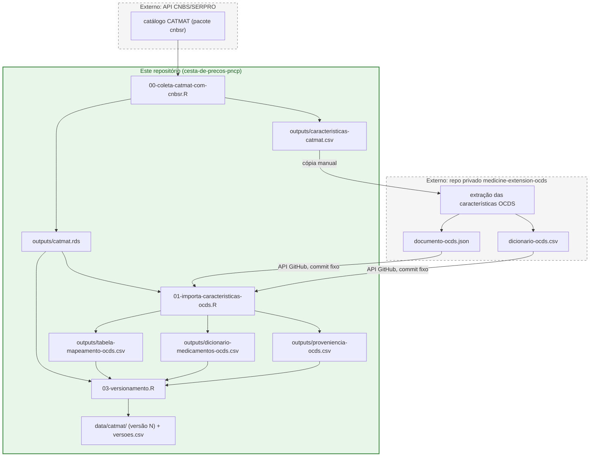

# Task: `atualiza-catmat`

Atualiza o catálogo CATMAT de medicamentos e versiona, em `data/catmat/`, todos os artefatos derivados dele:
o catálogo do banco, o catálogo do classificador, as características OCDS do banco e o dicionário OCDS usado na
publicação de dados abertos (`tasks/mapeamento-ocds`).

## Fluxo

O bloco verde é o que roda e fica gravado neste repositório; os blocos tracejados ficam fora dele. As setas que
cruzam a fronteira são a coleta da API pelo `00`, a cópia manual de `caracteristicas-catmat.csv` para o
`medicine-extension-ocds` e o download, pelo `01`, dos dois arquivos gerados lá.

| Script | O que faz |
| --- | --- |
| `00-coleta-catmat-com-cnbsr.R` | Coleta o CATMAT de medicamentos e grava `outputs/catmat.rds` e `outputs/caracteristicas-catmat.csv`. |
| (manual) | Envia `caracteristicas-catmat.csv` ao repositório `Transparencia-Brasil/medicine-extension-ocds` e roda lá a extração das características OCDS. |
| `01-importa-caracteristicas-ocds.R` | Baixa `documento-ocds.json` e `dicionario-ocds.csv` **do mesmo commit** do `medicine-extension-ocds`; gera `outputs/tabela-mapeamento-ocds.csv`, grava `outputs/dicionario-medicamentos-ocds.csv` (validado contra `outputs/catmat.rds`) e registra o commit em `outputs/proveniencia-ocds.csv`. |
| `02-testa-catmat-atualizado.R` | Simula a inserção do catálogo no banco. |
| `03-versionamento.R` | Promove os arquivos de `outputs/` para a versão N+1 em `data/catmat/`, move a versão N para `data/catmat/OLD/N/` e registra a nova versão em `data/catmat/versoes.csv`. |
| `backfill-dicionario-ocds.R` | Execução única (04/11/2026): incluiu o dicionário OCDS nas versões 0 e 1 já existentes e criou `versoes.csv`. Mantido como registro; rodá-lo de novo não altera nada. |

Execute a partir da raiz do repositório, em ordem, por exemplo `Rscript.exe tasks/atualiza-catmat/src/R/01-importa-caracteristicas-ocds.R`.

**Regra:** atualizou o CATMAT, o dicionário OCDS vem junto. O `01` e o `03` interrompem a execução se os códigos do
dicionário não coincidirem exatamente com os do catálogo novo. Nesse caso, a extração no `medicine-extension-ocds`
ainda não foi rodada para o catálogo novo.

## Arquivos de cada versão

| Arquivo em `data/catmat/` | Consumidor |
| --- | --- |
| `catmat-N.rds` | `src/ETL/loaders/carrega-catalogo.R` (tabela `catalogo`) |
| `catmat-N.csv` | classificador (`src/ETL/classificador/filtra-medicamentos.sh`) |
| `tabela-mapeamento-ocds-N.csv` | `carrega-catalogo.R` (coluna `catalogo.caracteristicas_ocds`) |
| `dicionario-medicamentos-ocds-N.csv` | mapeamento PNCP -> OCDS (`tasks/mapeamento-ocds`) |

A versão vigente é o maior N presente em `data/catmat/`; as anteriores ficam em `data/catmat/OLD/<N>/`.

## Histórico de versões (`data/catmat/versoes.csv`)

Uma linha por arquivo versionado:

| Coluna | Conteúdo |
| --- | --- |
| `versao` | N |
| `arquivo` | nome do arquivo (em `data/catmat/` se for a versão vigente; senão em `OLD/<N>/`) |
| `sha256` | hash do conteúdo; em `.csv`/`.json`, calculado após converter CRLF em LF (independe de `core.autocrlf`) |
| `linhas` | número de registros |
| `origem_repo`, `origem_caminho`, `origem_commit` | proveniência no `medicine-extension-ocds`; vazias quando desconhecidas (o catálogo vem da API CNBS) |
| `registrado_em` | data e hora do registro |

Proveniência conhecida até aqui:

- v0: o dicionário é o efetivamente usado nas publicações OCDS de 2025/01 a 2026/04 (commit `15d5f37`). O commit da
  tabela de características não foi registrado à época.
- v1: o dicionário e a tabela de características vêm do commit `9b4c3d1`. O `01` rodado hoje sobre esse conteúdo
  reproduz `tabela-mapeamento-ocds-1.csv` byte a byte.

## Configuração

Variáveis no `.env` (ver `.env.example`):

- `GITHUB_TOKEN_READ_FILES`: token com leitura do repositório privado `Transparencia-Brasil/medicine-extension-ocds`.
- `MEDICINE_EXTENSION_REF` (opcional): branch, tag ou SHA a usar no `01`. O padrão é `main`; o SHA resolvido é o que
  fica registrado.

Variáveis já definidas no ambiente têm precedência sobre o `.env`, por exemplo
`GITHUB_TOKEN_READ_FILES="$(gh auth token)" Rscript.exe ...`.

O `03-versionamento.R` aceita `CATMAT_DIR` e `ATUALIZACAO_DIR` para rodar sobre uma cópia, útil em testes. Os padrões
são `data/catmat` e `tasks/atualiza-catmat/outputs`.
